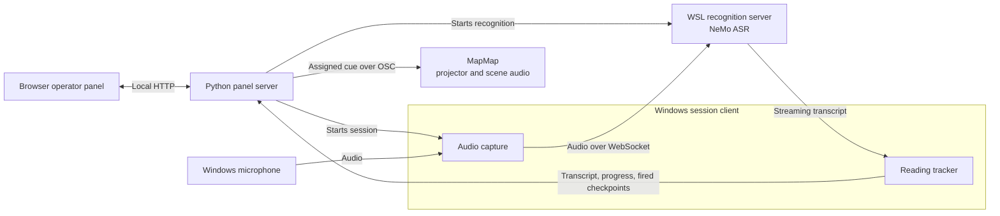

# Books to Life Reading Pod

The Reading Pod listens as a child reads aloud, follows their place in the
selected story, and plays sound and projection cues at authored checkpoints.

## Start on this Windows PC

1. Double-click **Start Reading Pod Panel.cmd** in this folder. Keep its
   terminal open. It opens the [operator panel](http://127.0.0.1:8765) using
   the MapMap handoff installed on this PC.
2. Select **Mila and the Sky Garden**, **Nemotron · 160 ms**, and your
   **Microphone**. Under **Preflight**, click **Start recognition server** and
   wait for **Ready**. Click **Open MapMap** and wait for **Running · OSC connected**.
3. For projection, set Windows displays to **Extend**, choose the projector in
   MapMap under **View → Output screen**, and press **Ctrl+F**. Use **Reset to
   grid** in the panel to check alignment.
4. Click **Start experience** and wait for **Listening**. Check **Input in use**,
   then read “Mila found a tiny silver seed beside the old gate.” The transcript
   should update, `seed_found` should fire once, and MapMap should play the Silver
   Seed scene and its soundtrack.
5. Click **End experience** to stop listening and return the projection to the
   grid. When finished, close MapMap and press **Ctrl+C** in the panel terminal.
   Recognition started from the panel can stay running for the next session.

## Set up a fresh Windows checkout

Install Git, Python 3.12 with the Windows `py` launcher, Node.js 22 with npm, and
Qt 6.12.0 with Qt Multimedia and the MinGW 64-bit toolchain. The default live
recognizer also needs Ubuntu 24.04 in WSL 2 with working NVIDIA CUDA and the
Ubuntu packages listed in the [setup prerequisites](docs/READING_POD_SETUP.md#prerequisites).

Run these commands from the repository root in PowerShell. The first command
builds the panel and the patched MapMap renderer, installs the Windows client
and WSL recognition dependencies, and downloads the default Nemotron model.
Use the second command for everyday startup on this installation.

```powershell
powershell.exe -NoProfile -ExecutionPolicy Bypass -File .\Setup-Reading-Pod.ps1
powershell.exe -NoProfile -ExecutionPolicy Bypass -File .\scripts\reading-pod\Start-Panel.ps1
```

Pass `-Distro` to setup if `wsl.exe --list --verbose` shows a name other than
`Ubuntu`. Pass `-QtBin` and `-MinGWBin` if Qt or MinGW is installed in a different
location. Use `-SkipRecognition` for panel and projection setup without local
NeMo. Setup builds its own copy of MapMap under `output/reading-pod/` from a
pinned upstream revision and the [Reading Pod patch](pod/mapmap/reading-pod.patch).
The batch launcher above expects the existing handoff under `output/mapmap-other-pc/`.

## How the parts connect

The panel manages startup. During a reading session, the microphone starts the
data flow, and the recognition server runs the automatic speech recognition (ASR)
model.



| Part | What it does |
| --- | --- |
| **Panel** | The [React interface](operator-panel/src/main.jsx) calls the [local Python panel server](books_to_life/cli/operator_panel.py) over HTTP at `127.0.0.1:8765`. The server starts WSL recognition and launches a Windows session client when you click **Start experience**. |
| **Microphone and client** | The [session client](books_to_life/cli/run_client.py) opens the selected Windows audio device through PyAudio and streams audio to the recognizer. For the default NeMo model the client sends 80 ms packets. |
| **Recognition server and ASR** | The [NeMo server](books_to_life/cli/run_nemo_server.py) runs inside WSL and exchanges audio and transcript updates with the client over WebSocket at `127.0.0.1:9097`. The default Nemotron model processes 160 ms chunks. With **Reading hints** enabled, the client can also send upcoming checkpoint phrases to the model. |
| **Tracker** | The [matcher](books_to_life/matching/timely_matcher.py) runs inside the same Windows client. It aligns transcript updates against the selected book's full passage and checks whether a checkpoint has enough evidence to fire its effect. The panel backend reads the client's transcript, progress, and trigger events and exposes them to the browser. |
| **MapMap** | When a checkpoint fires and has an assigned scene, the [panel's MapMap integration](books_to_life/runtime/mapmap_cues.py) sends an OSC command over local UDP port `12346`. MapMap renders the selected story's media on the calibrated walls. A ready scene with its own soundtrack can replace the local checkpoint sound. |

The panel loads passages and checkpoints from
[`recordings/library/stories/`](recordings/README.md), projection media from
[`scenes/`](scenes/README.md), and cue assignments from its MapMap configuration.
Session transcripts go to `output/operator-sessions/`. The client saves a WAV
there when **Save recording** is enabled. Book preparation happens upstream of
this runtime. A book's manifest and media need to be available locally before
the panel can use them.

## Troubleshooting and more detail

| If you see | Check |
| --- | --- |
| Panel asks you to build React | Run `npm.cmd --prefix operator-panel ci` and then `npm.cmd --prefix operator-panel run build` from the root. |
| Recognition stays unavailable | Check **Preflight** and `output/operator-server/nemo.log` for WSL, CUDA, or model startup errors. |
| Microphone is silent or missing | Check Windows microphone permissions, refresh the panel, and confirm **Input in use** after starting. |
| No projection cue | Check **Preflight → Check setup**, confirm MapMap is using OSC port `12346`, and use **Edit MapMap cues** to check the assignment. |

- [Detailed startup for this PC](docs/READING_POD_STARTUP.md)
- [Panel controls, scene imports and wall calibration](operator-panel/README.md)
- [Other recognition engines and platforms](docs/RUNNING.md)
- [Tracker and effect policies](docs/EFFECT_POLICIES.md)
- [Project status](docs/PROJECT_STATUS.md) and [benchmarks](benchmarks/README.md)
